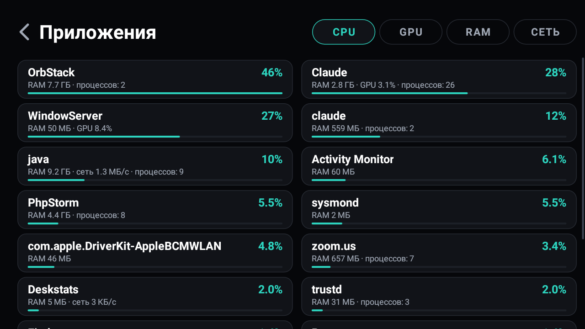

# deskstats

[](https://github.com/danijar2000/deskstats/actions/workflows/build.yml)

**English** · [Русский](docs/README.ru.md) · [Español](docs/README.es.md) · [Deutsch](docs/README.de.md) · [Français](docs/README.fr.md) · [Português](docs/README.pt.md) · [中文](docs/README.zh.md) · [日本語](docs/README.ja.md)

Turn an old Android phone into a status panel for your Mac: a clock, the weather, notifications
from the Mac and the iPhone, the battery of your mouse and keyboard, and CPU, GPU, memory and
network load with live charts.

- **The Mac side** is a tiny background app: about 4 MB of memory and half a percent of one
  core while the phone is connected, nothing at all when it is not.
- **The phone** connects over the USB cable or over Wi‑Fi and switches between them by itself.
  It sleeps and wakes with the Mac.
- **Everything is set up on the phone**: language, theme, orientation, which blocks to show,
  how often to update, Wi‑Fi access.

## Screenshots

| | |
|---|---|
|  |  |
| **Dark** theme, the default | **Neon** theme |
|  |  |
| **Light** theme | **Portrait** orientation |
|  |  |
| Tap a load card: the Mac's apps sorted by that load | Tap the notifications: the full list with texts |
|  |  |
| Tap the clock or the weather: pick a city | The gear: settings |

## Requirements

- **A Mac** with macOS 11 or later (Apple silicon or Intel).
- **An Android phone** with Android 2.3 or later. The USB link needs Android 5.0; older phones
  use Wi‑Fi only.
- **adb** on the Mac for the USB link: `brew install android-platform-tools`.
- **USB debugging** on the phone: Settings → About phone, tap "Build number" seven times, then
  Settings → Developer options → USB debugging. Allow debugging for this Mac when the phone asks.

## Install

Connect the phone with a cable and run:

```bash
curl -fsSL https://raw.githubusercontent.com/danijar2000/deskstats/main/setup.sh | bash
```

It downloads the latest [release](https://github.com/danijar2000/deskstats/releases), installs
the Mac app in `~/Applications/Deskstats.app` so that it starts at login, and installs the app
on the phone. A few seconds later the Mac opens the panel on the phone and pairs with it.

No phone on a cable? Add `-s -- --no-phone` after `bash` and install
[deskstats.apk](https://github.com/danijar2000/deskstats/releases/latest/download/deskstats.apk)
yourself.

**No cable or no adb?** Then the script shows a QR code with the link to the app: scan it with the phone, install the app and open it. With the phone on the same Wi‑Fi it finds the computer by itself; tap it and allow the phone on the computer. adb is only needed for the USB cable.

### Mac permissions

Open System Settings → Privacy & Security and allow **Deskstats**:

- **Full Disk Access** — for the notifications of Mac apps.
- **Accessibility** — for notifications forwarded from the iPhone. macOS keeps those only on
  screen, so Deskstats reads them while a banner is shown or the Notification Center is open.

Everything else works without them. Deskstats notices the permissions by itself within half a
minute. After an update macOS asks for them again; if a switch is already on but nothing
arrives, remove Deskstats from the list (−) and add `~/Applications/Deskstats.app` again.

### Linux and Windows

The server also runs on Linux (x86-64 and ARM64, any distribution with systemd) and on Windows 10 or later (64-bit; on ARM, Windows 11 runs the Intel/AMD build). The phone app is the same.

Linux, in a terminal (a fresh Ubuntu has no curl: `sudo apt install curl` first):

```bash
curl -fsSL https://raw.githubusercontent.com/danijar2000/deskstats/main/setup.sh | bash
```

Windows, in PowerShell:

```powershell
irm https://raw.githubusercontent.com/danijar2000/deskstats/main/setup.ps1 | iex
```

- On Linux the server lives in `~/.local/bin/deskstats` and starts at login as a systemd user service; on Windows it lives in `%LOCALAPPDATA%\deskstats` and starts at sign-in, with its log in `%APPDATA%\deskstats\log.txt`.
- For the USB cable install adb: `sudo apt install android-tools-adb` (or your distribution's package) or `winget install Google.PlatformTools`.
- For Wi‑Fi let TCP 8787 and UDP 8788 through the firewall. To let a phone in over Wi‑Fi, Linux needs `zenity` or `kdialog` to show the question.
- Not there yet on these systems: notifications, the battery of mouse and keyboard on Windows, GPU load on Windows and on Linux other than AMD, and the phone going dark with the display.

## Use

- **Load cards** (CPU, GPU, RAM, Network) open the Mac's applications sorted by that load. CPU
  is counted per core, as in Activity Monitor: an app busy on three cores shows 300 %.
- **Clock and weather** open the list of cities: add several, choose one, remove with ×.
  The clock, the date, notification times and the weather follow the chosen city.
- **Notifications** open the full list.
- **The gear** opens the settings: language (8 languages), theme (dark, light, neon),
  orientation (landscape, portrait, auto), the blocks of the main screen, Wi‑Fi connection,
  Mac notifications, update interval and weather refresh.
- **Several Macs**: Macs running deskstats on the same Wi‑Fi appear in the settings under Macs, like
  devices in LocalSend. Tap one: the phone and the Mac show the same six-digit code, and the Mac asks
  whether to let the phone in. Connecting the phone to a Mac with the cable once adds it too. Swipe
  the main screen left or right to switch; the dots at the top show which Mac is shown. × forgets a Mac.
- **Back** closes a page; an unattended page closes by itself after a few minutes.

To avoid burn-in the picture moves a few pixels every two minutes and the screen dims after
five minutes without the Mac. The panel starts after the phone reboots (up to Android 9; on
newer phones the Mac opens it over USB).

## Update and remove

Update: run the install command again. If the phone refuses the new app because of a different
signature, remove the old one (its settings are lost) and run the command again:

```bash
adb uninstall app.deskstats
```

Remove the Mac app:

```bash
curl -fsSL https://raw.githubusercontent.com/danijar2000/deskstats/main/setup.sh | bash -s -- --uninstall
```

The pairing key stays in `~/Library/Application Support/deskstats` (delete the folder to forget
the phone); the entries in Privacy & Security can only be removed there by hand.

On Linux the same command removes the server; on Windows, in PowerShell:

```powershell
& ([scriptblock]::Create((irm https://raw.githubusercontent.com/danijar2000/deskstats/main/setup.ps1))) -Uninstall
```

The pairing key stays in `~/.config/deskstats` on Linux and in `%APPDATA%\deskstats` on Windows.

## Troubleshooting

| What you see | What to do |
|---|---|
| "Mac · no connection" | Check the cable and `adb devices` (the phone must be listed as `device`). Over Wi‑Fi: switch Wi‑Fi on in the panel's settings while on the cable, and keep both on one network. |
| "token needed: connect the phone by USB" | Connect the cable: the Mac pairs the phone by itself. |
| "the server refused (code N)" | The phone app and the Mac app are of different versions: update both. |
| No notifications | Allow the permissions above. |
| No weather | Choose a city: tap the weather. |

## Security

The phone and the Mac encrypt everything they send each other with a key the phone gets either
over the cable, or over Wi‑Fi once the Mac's user allows it: the phone and the Mac then agree on a
secret by ECDH (P-256), both show a six-digit code made from it, and the key travels encrypted
with that secret. Requests without the key are refused before anything runs. Every Mac announces
its name, model and address on the local network so that phones can list it; nothing else is open.
Nothing leaves the Mac except the coordinates of the chosen city, sent to open-meteo.com for the weather.

## Build from source

```bash
(cd server && cargo test && ./install.sh)
(cd android && ./gradlew :app:assembleRelease)
```

On Linux the server is installed with `./install-linux.sh`, on Windows with
`powershell -ExecutionPolicy Bypass -File install.ps1` (both in `server`, both build it first).

The server needs Rust; the app needs JDK 17+ and the Android SDK with platform 34.
[GitHub Actions](.github/workflows/build.yml) builds both on every push and publishes a release
for every `v*` tag.
