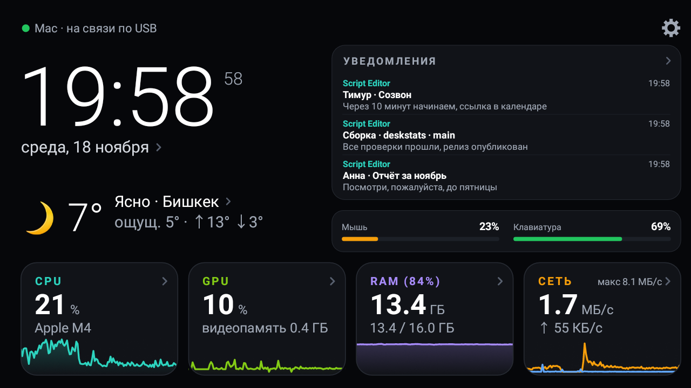
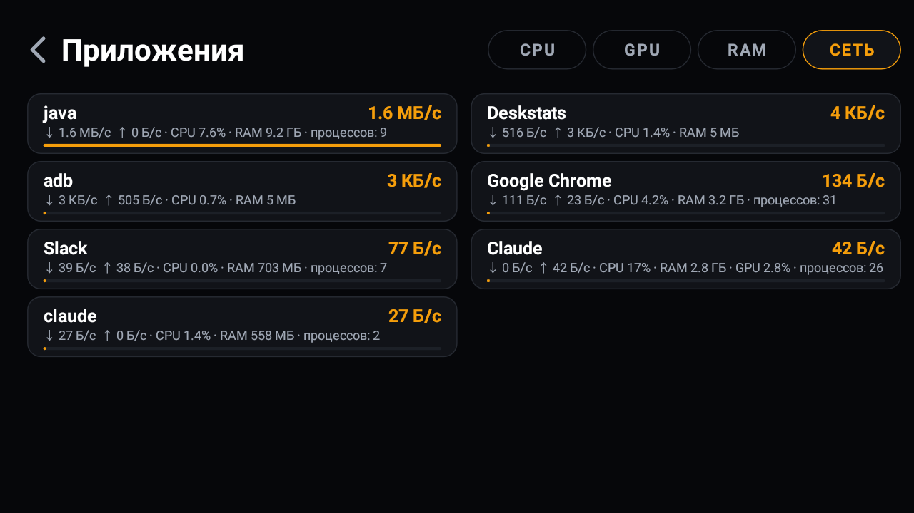
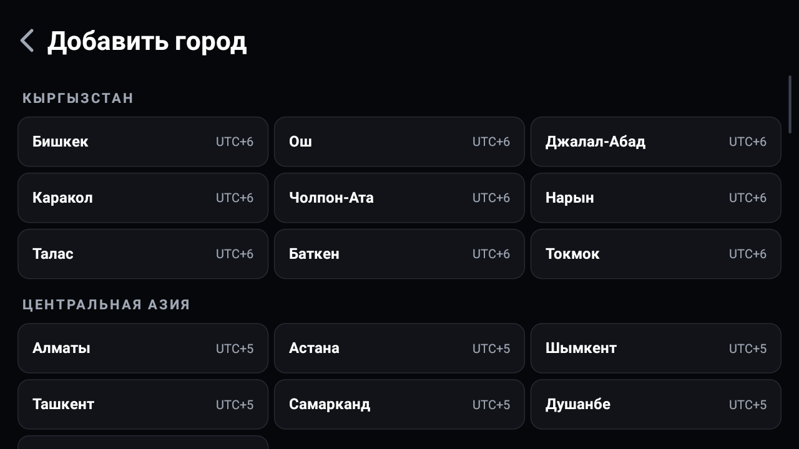
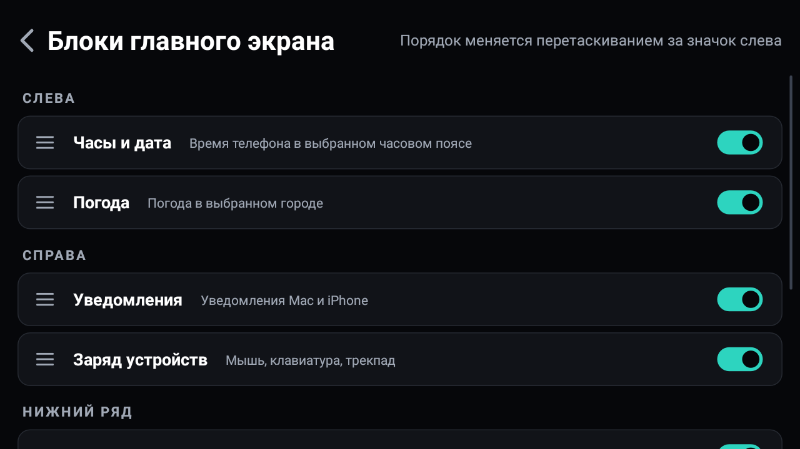

# deskstats

[](https://github.com/danijar2000/deskstats/actions/workflows/build.yml)

Старый Android-телефон на столе превращается в тёмную панель для Mac: часы, погода,
уведомления Mac и iPhone, заряд мыши и клавиатуры, нагрузка процессора, видеоядра, памяти и
сети с графиками.



- **Сервер** работает на Mac в фоне и почти ничего не тратит: около 4 МБ памяти и полпроцента
  одного ядра, а когда телефон не подключён — ничего.
- **Телефон** подключается по USB-кабелю или по Wi-Fi и сам переключается между ними. Засыпает
  и просыпается вместе с Mac: пока Mac спит, экран телефона чёрный.

## Что умеет

| | |
|---|---|
|  | **Нажмите на карточку нагрузки** — откроется список программ на Mac, отсортированный по этой нагрузке: процессор, видеоядро, память или сеть. Вкладки сверху переключают сортировку. |
|  | Во вкладке «Сеть» видно, какая программа сколько скачивает и отдаёт. |
|  | **Нажмите на уведомления** — откроется полный список; выбранное уведомление показано целиком справа. Новое уведомление на главном экране на несколько секунд показывается крупно. |
|  | **Нажмите на часы или погоду** — откроется выбор города. Часы, дата, время уведомлений и погода переходят на выбранный город. Можно сохранить несколько городов. |
|  | Около 90 городов по регионам. |
|  | **Шестерёнка** справа вверху — список блоков: их можно скрывать и менять местами. Остальные блоки занимают освободившееся место. |

## Что нужно

- **Mac** с macOS 11 или новее (Apple silicon или Intel).
- **Android-телефон** с Android 2.3 или новее. Связь по USB — с Android 5.0; на более старых
  только по Wi-Fi, но и им первый раз нужен кабель.
- **adb** на Mac для связи по USB: `brew install android-platform-tools`.
- На телефоне включена **«Отладка по USB»**: «Настройки → О телефоне», семь раз нажать «Номер
  сборки», затем «Настройки → Для разработчиков → Отладка по USB». При первом подключении на
  телефоне нужно разрешить отладку для этого Mac.

## Установка

Подключите телефон к Mac кабелем и выполните одну команду:

```bash
curl -fsSL https://raw.githubusercontent.com/danijar2000/deskstats/main/setup.sh | bash -s -- --city Bishkek --lan
```

Она скачивает готовые сборки из [Releases](https://github.com/danijar2000/deskstats/releases),
ставит сервер в `~/Applications/Deskstats.app` с автозапуском при входе в систему и, если
телефон подключён, ставит на него приложение. Через несколько секунд сервер сам откроет панель
на телефоне и передаст ей ключ.

- `--city Bishkek` — город для погоды, пока на телефоне не выбран другой; можно не указывать.
- `--lan` — разрешить связь по Wi-Fi; без него — только по кабелю.
- Телефон без кабеля: добавьте `--no-phone`, а APK
  ([deskstats.apk](https://github.com/danijar2000/deskstats/releases/latest/download/deskstats.apk))
  поставьте сами.

### Разрешения на Mac

После установки откройте «Системные настройки → Конфиденциальность и безопасность» и включите
для **Deskstats**:

- **Полный доступ к диску** — для уведомлений приложений Mac.
- **Универсальный доступ** — для уведомлений, пересланных с iPhone. macOS хранит их только на
  экране, поэтому сервер читает окно Центра уведомлений: он видит их, пока показан баннер или
  открыт Центр уведомлений.

Без разрешений всё остальное работает, блок уведомлений подскажет, чего не хватает. Перезапускать
сервер не нужно — он сам заметит разрешения в течение полуминуты.

macOS привязывает разрешения к файлу программы: после обновления сервера их нужно выдать снова.
Если переключатель уже включён, а уведомлений нет — удалите Deskstats из списка («−») и добавьте
`~/Applications/Deskstats.app` заново.

## Как пользоваться

- **Карточки CPU, GPU, RAM, Сеть** — нажатие открывает список программ по этой нагрузке. У
  процессора проценты считаются от одного ядра, как в «Мониторинге системы»: программа на трёх
  ядрах показывает 300 %.
- **Часы и погода** — нажатие открывает выбор города. «Как на телефоне и Mac» — часовой пояс
  телефона и город из `--city`. Крестик у города удаляет его, «Вернуть» внизу — отменяет.
- **Уведомления** — нажатие открывает полный список.
- **Шестерёнка** — список блоков: переключатель скрывает блок, значок слева перетаскивает.
- **Назад** закрывает страницу. Страница без касаний закрывается сама через 3 минуты (список
  программ — через 10).
- Строка вверху показывает, как связан телефон: по USB, по Wi-Fi или нет связи.

Против выгорания экрана картинка раз в две минуты немного сдвигается, а через пять минут без
связи с Mac экран тускнеет. После перезагрузки телефона панель открывается сама (до Android 9;
на более новых её откроет сервер по USB или запустите её сами).

## Обновление и удаление

Обновить — та же команда установки. Если телефон пишет, что приложение с другой подписью,
удалите его (настройки блоков и городов сбросятся) и запустите установку снова:

```bash
adb uninstall app.deskstats
```

Удалить сервер:

```bash
curl -fsSL https://raw.githubusercontent.com/danijar2000/deskstats/main/setup.sh | bash -s -- --uninstall
```

Ключ останется в `~/Library/Application Support/deskstats` (удалите папку, чтобы забыть
телефон), а записи Deskstats в настройках конфиденциальности удаляются только вручную.

## Параметры сервера

Те же параметры передаются команде установки после `--`; чтобы поменять их, запустите установку
ещё раз с новыми.

| Параметр | Что делает |
|---|---|
| `--interval <секунды>` | как часто замерять нагрузку, от 0.2 до 3600, по умолчанию 1 |
| `--port <порт>` | порт, по умолчанию 8787 |
| `--city <город>` | погода, пока на телефоне не выбран город, например `Bishkek` |
| `--weather-hours <часы>` | как часто обновлять погоду, от 0.25 до 168, по умолчанию 1 |
| `--lan` | отвечать и по Wi-Fi |
| `--no-alerts` | не показывать уведомления |
| `--no-adb` | не настраивать связь по USB |

Журнал сервера — `~/Library/Logs/deskstats.log`.

## Если что-то не так

| Что видно | Что сделать |
|---|---|
| «Mac · нет связи» | Проверьте кабель и `adb devices` (телефон должен быть в списке как `device`). По Wi-Fi: сервер установлен с `--lan`, телефон и Mac в одной сети. |
| «нужен токен: подключите телефон по USB» | Подключите кабель — сервер сам передаст ключ. |
| «сервер отказал (код N)» | На телефоне старая версия приложения или на Mac старый сервер — обновите оба. |
| Нет уведомлений | Выдайте разрешения (см. выше). |
| Нет погоды | Укажите `--city` при установке или выберите город на телефоне. |
| Карточка GPU пишет «нет данных о видеоядре» | Этот Mac не сообщает загрузку видеоядра. |

## Безопасность

Телефон и сервер шифруют всё, что передают друг другу, ключом, который телефон один раз получает
по кабелю; сам ключ по сети не ходит. Чужие запросы сервер отклоняет, ничего не запуская. Сервер
не отправляет никуда данные, кроме названия города или координат для погоды на open-meteo.com.

## Сборка из исходников

Как собрать самому, как устроены связь и запросы — в [docs/protocol.md](docs/protocol.md).
Сборки для релизов делает [GitHub Actions](.github/workflows/build.yml): на каждый push
проверяются и собираются сервер и APK, а тег `v*` публикует их в Releases.
