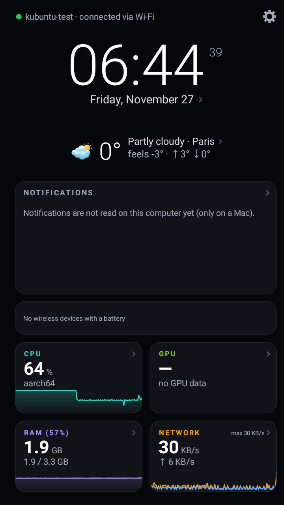

# deskstats

[](https://github.com/danijar2000/deskstats/actions/workflows/build.yml)

[English](../README.md) · [Русский](README.ru.md) · **Español** · [Deutsch](README.de.md) · [Français](README.fr.md) · [Português](README.pt.md) · [中文](README.zh.md) · [日本語](README.ja.md)

Convierte un viejo teléfono Android en un panel de estado para tu Mac: reloj, tiempo,
notificaciones del Mac y del iPhone, batería del ratón y del teclado, y carga de CPU, GPU,
memoria y red con gráficos en directo.


- **En el Mac** corre una app diminuta en segundo plano: unos 4 MB de memoria y medio por ciento
  de un núcleo mientras el teléfono está conectado, y nada cuando no lo está.
- **El teléfono** se conecta por cable USB o por Wi‑Fi y cambia de uno a otro por sí solo.
  Se duerme y se despierta junto con el Mac.
- **Todo se configura en el teléfono**: idioma, tema, orientación, qué bloques mostrar,
  cada cuánto actualizar, acceso por Wi‑Fi.

## Capturas

| | |
|---|---|
|  |  |
| Tema **Oscuro**, el predeterminado | Tema **Neón** |
|  |  |
| Tema **Claro** | Orientación **Vertical** |
|  |  |
| Toca una tarjeta de carga: las apps del Mac ordenadas por esa carga | Toca las notificaciones: la lista completa con sus textos |
|  |  |
| Toca el reloj o el tiempo: elige una ciudad | El engranaje: ajustes |

## Requisitos

- **Un Mac** con macOS 11 o posterior (Apple silicon o Intel).
- **Un teléfono Android** con Android 2.3 o posterior. La conexión USB requiere Android 5.0; los
  teléfonos más antiguos solo usan Wi‑Fi, pero también necesitan el cable una vez.
- **adb** en el Mac para la conexión USB: `brew install android-platform-tools`.
- **Depuración por USB** en el teléfono: Ajustes → Información del teléfono, toca "Número de
  compilación" siete veces y luego Ajustes → Opciones para desarrolladores → Depuración por USB.
  Permite la depuración para este Mac cuando el teléfono lo pregunte.

## Instalación

Conecta el teléfono con un cable y ejecuta:

```bash
curl -fsSL https://raw.githubusercontent.com/danijar2000/deskstats/main/setup.sh | bash
```

Descarga la última [versión](https://github.com/danijar2000/deskstats/releases), instala la app
del Mac en `~/Applications/Deskstats.app` para que arranque al iniciar sesión e instala la app
en el teléfono. Unos segundos después, el Mac abre el panel en el teléfono y se empareja con él.

¿No tienes el teléfono conectado por cable? Añade `-s -- --no-phone` después de `bash` e instala
[deskstats.apk](https://github.com/danijar2000/deskstats/releases/latest/download/deskstats.apk)
por tu cuenta.

### Permisos en el Mac

Abre Ajustes del Sistema → Privacidad y seguridad y autoriza a **Deskstats** en:

- **Acceso total al disco**: para las notificaciones de las apps del Mac.
- **Accesibilidad**: para las notificaciones reenviadas desde el iPhone. macOS solo las mantiene
  en pantalla, así que Deskstats las lee mientras se muestra un aviso o el Centro de
  notificaciones está abierto.

Todo lo demás funciona sin ellos. Deskstats detecta los permisos por sí solo en medio minuto.
Tras una actualización, macOS vuelve a pedirlos; si el interruptor ya está activado pero no llega
nada, quita Deskstats de la lista (−) y vuelve a añadir `~/Applications/Deskstats.app`.

## Uso

- **Las tarjetas de carga** (CPU, GPU, RAM, Red) abren las aplicaciones del Mac ordenadas por esa
  carga. La CPU se cuenta por núcleo, como en el Monitor de Actividad: una app que ocupa tres
  núcleos muestra 300 %.
- **El reloj y el tiempo** abren la lista de ciudades: añade varias, elige una, quítalas con ×.
  El reloj, la fecha, la hora de las notificaciones y el tiempo siguen a la ciudad elegida.
- **Las notificaciones** abren la lista completa.
- **El engranaje** abre los ajustes: idioma (8 idiomas), tema (oscuro, claro, neón),
  orientación (horizontal, vertical, auto), los bloques de la pantalla principal, conexión por
  Wi‑Fi, notificaciones del Mac, intervalo de actualización y actualización del tiempo.
- **Varios Mac**: conecta el teléfono por cable a cada Mac una vez y los recordará todos. Desliza
  la pantalla principal a la izquierda o a la derecha para cambiar; los puntos de arriba muestran
  qué Mac se ve. La lista (× para olvidar un Mac) está en los ajustes, en Macs.
- **Atrás** cierra una página; una página desatendida se cierra sola al cabo de unos minutos.

Para evitar el quemado de pantalla, la imagen se desplaza unos píxeles cada dos minutos y la
pantalla se atenúa tras cinco minutos sin el Mac. El panel se inicia cuando el teléfono se
reinicia (hasta Android 9; en teléfonos más nuevos lo abre el Mac por USB).

## Actualizar y desinstalar

Para actualizar, vuelve a ejecutar el comando de instalación. Si el teléfono rechaza la nueva app
por tener otra firma, desinstala la anterior (se pierden sus ajustes) y ejecuta el comando de nuevo:

```bash
adb uninstall app.deskstats
```

Desinstalar la app del Mac:

```bash
curl -fsSL https://raw.githubusercontent.com/danijar2000/deskstats/main/setup.sh | bash -s -- --uninstall
```

La clave de emparejamiento se queda en `~/Library/Application Support/deskstats` (borra la
carpeta para olvidar el teléfono); las entradas de Privacidad y seguridad solo se pueden quitar
allí a mano.

## Solución de problemas

| Qué ves | Qué hacer |
|---|---|
| "Mac · sin conexión" | Revisa el cable y `adb devices` (el teléfono debe aparecer como `device`). Por Wi‑Fi: activa la conexión por Wi‑Fi en los ajustes del panel mientras está conectado por cable, y mantén ambos en la misma red. |
| "falta el token: conecta el teléfono por USB" | Conecta el cable: el Mac empareja el teléfono por sí solo. |
| "el servidor rechazó la conexión (código N)" | La app del teléfono y la del Mac son de versiones distintas: actualiza ambas. |
| No hay notificaciones | Concede los permisos de arriba. |
| No hay tiempo | Elige una ciudad: toca el tiempo. |

## Seguridad

El teléfono y el Mac cifran todo lo que se envían con una clave que el teléfono recibe una sola
vez por cable; la clave nunca viaja por la red. Las peticiones sin ella se rechazan antes de
ejecutar nada. Del Mac no sale nada salvo las coordenadas de la ciudad elegida, que se envían a
open-meteo.com para obtener el tiempo.

## Compilar desde el código fuente

```bash
(cd server && cargo test && ./install.sh)
(cd android && ./gradlew :app:assembleRelease)
```

El servidor necesita Rust; la app necesita JDK 17+ y el Android SDK con la plataforma 34.
[GitHub Actions](../.github/workflows/build.yml) compila ambos en cada push y publica una versión
por cada etiqueta `v*`.
