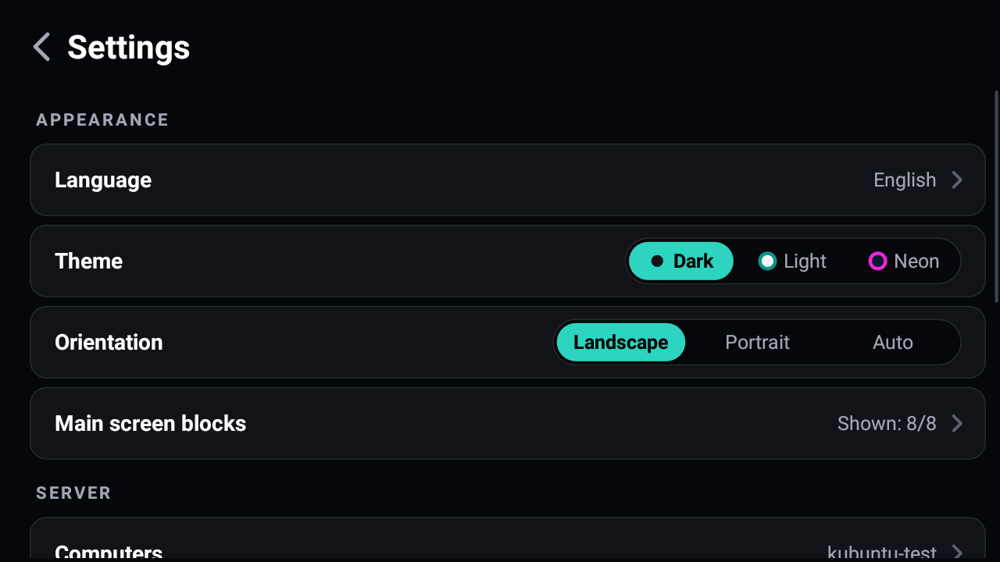

# deskstats

[](https://github.com/danijar2000/deskstats/actions/workflows/build.yml)

[English](../README.md) · [Русский](README.ru.md) · [Español](README.es.md) · [Deutsch](README.de.md) · **Français** · [Português](README.pt.md) · [中文](README.zh.md) · [日本語](README.ja.md)

Transformez un vieux téléphone Android en panneau d'état pour votre Mac : horloge, météo,
notifications du Mac et de l'iPhone, batterie de la souris et du clavier, et charge CPU, GPU,
mémoire et réseau avec des graphiques en direct.

- **Côté Mac**, une minuscule app en arrière-plan : environ 4 Mo de mémoire et un demi-pour-cent
  d'un cœur quand le téléphone est connecté, rien du tout sinon.
- **Le téléphone** se connecte par câble USB ou en Wi‑Fi et passe de l'un à l'autre tout seul.
  Il se met en veille et se réveille avec le Mac.
- **Tout se règle sur le téléphone** : langue, thème, orientation, blocs à afficher, fréquence
  d'actualisation, accès Wi‑Fi.

## Captures d'écran

| | |
|---|---|
|  |  |
| Thème **Sombre**, par défaut | Thème **Néon** |
|  |  |
| Thème **Clair** | Orientation **Portrait** |
|  |  |
| Touchez une carte de charge : les apps du Mac triées selon cette charge | Touchez les notifications : la liste complète avec les textes |
|  |  |
| Touchez l'horloge ou la météo : choisissez une ville | L'engrenage : les réglages |

## Prérequis

- **Un Mac** sous macOS 11 ou ultérieur (Apple silicon ou Intel).
- **Un téléphone Android** sous Android 2.3 ou ultérieur. La liaison USB nécessite Android 5.0 ;
  les téléphones plus anciens n'utilisent que le Wi‑Fi.
- **adb** sur le Mac pour la liaison USB : `brew install android-platform-tools`.
- **Le débogage USB** sur le téléphone : Paramètres → À propos du téléphone, touchez sept fois
  « Numéro de build », puis Paramètres → Options pour les développeurs → Débogage USB. Autorisez
  le débogage pour ce Mac quand le téléphone le demande.

## Installation

Branchez le téléphone avec un câble et lancez :

```bash
curl -fsSL https://raw.githubusercontent.com/danijar2000/deskstats/main/setup.sh | bash
```

Le script télécharge la dernière [version](https://github.com/danijar2000/deskstats/releases),
installe l'app Mac dans `~/Applications/Deskstats.app` pour qu'elle démarre à l'ouverture de
session, et installe l'app sur le téléphone. Quelques secondes plus tard, le Mac ouvre le panneau
sur le téléphone et s'appaire avec lui.

Pas de téléphone branché ? Ajoutez `-s -- --no-phone` après `bash` et installez
[deskstats.apk](https://github.com/danijar2000/deskstats/releases/latest/download/deskstats.apk)
vous-même.

**Pas de câble ou pas d'adb ?** Le script affiche alors un code QR avec le lien vers l'app : scannez-le avec le téléphone, installez l'app et ouvrez-la. Sur le même Wi‑Fi, elle trouve l'ordinateur toute seule ; touchez-le et autorisez le téléphone sur l'ordinateur. adb ne sert que pour le câble USB.

### Autorisations sur le Mac

Ouvrez Réglages Système → Confidentialité et sécurité et autorisez **Deskstats** dans :

- **Accès complet au disque** — pour les notifications des apps du Mac.
- **Accessibilité** — pour les notifications transférées depuis l'iPhone. macOS ne les conserve
  qu'à l'écran, donc Deskstats les lit pendant qu'une bannière est affichée ou que le Centre de
  notifications est ouvert.

Tout le reste fonctionne sans elles. Deskstats détecte les autorisations tout seul en moins d'une
demi-minute. Après une mise à jour, macOS les redemande ; si un interrupteur est déjà activé mais
que rien n'arrive, retirez Deskstats de la liste (−) puis ajoutez à nouveau
`~/Applications/Deskstats.app`.

### Linux et Windows

Le serveur fonctionne aussi sous Linux (x86-64 et ARM64, toute distribution avec systemd) et sous Windows 10 ou ultérieur (64 bits). L'app du téléphone est la même.

Linux, dans un terminal :

```bash
curl -fsSL https://raw.githubusercontent.com/danijar2000/deskstats/main/setup.sh | bash
```

Windows, dans PowerShell :

```powershell
irm https://raw.githubusercontent.com/danijar2000/deskstats/main/setup.ps1 | iex
```

- Sous Linux, le serveur se trouve dans `~/.local/bin/deskstats` et démarre à l'ouverture de session comme service utilisateur systemd ; sous Windows, il se trouve dans `%LOCALAPPDATA%\deskstats`, démarre à l'ouverture de session et écrit son journal dans `%APPDATA%\deskstats\log.txt`.
- Pour le câble USB, installez adb : `sudo apt install android-tools-adb` (ou le paquet de votre distribution) ou `winget install Google.PlatformTools`.
- Pour le Wi‑Fi, ouvrez TCP 8787 et UDP 8788 dans le pare-feu. Pour laisser entrer un téléphone par Wi‑Fi, Linux a besoin de `zenity` ou de `kdialog` pour poser la question.
- Pas encore disponible sur ces systèmes : les notifications, la batterie de la souris et du clavier sous Windows, la charge du GPU sous Windows et sous Linux hors AMD, et l'extinction du téléphone avec l'écran.

## Utilisation

- **Les cartes de charge** (CPU, GPU, RAM, Réseau) ouvrent les applications du Mac triées selon
  cette charge. Le CPU est compté par cœur, comme dans le Moniteur d'activité : une app qui occupe
  trois cœurs affiche 300 %.
- **L'horloge et la météo** ouvrent la liste des villes : ajoutez-en plusieurs, choisissez-en une,
  supprimez avec ×. L'horloge, la date, l'heure des notifications et la météo suivent la ville
  choisie.
- **Les notifications** ouvrent la liste complète.
- **L'engrenage** ouvre les réglages : langue (8 langues), thème (sombre, clair, néon),
  orientation (paysage, portrait, auto), blocs de l'écran principal, connexion Wi‑Fi,
  notifications du Mac, intervalle d'actualisation et actualisation de la météo.
- **Plusieurs Mac** : les Mac qui exécutent deskstats sur le même Wi‑Fi apparaissent dans les réglages,
  rubrique Mac, comme les appareils dans LocalSend. Touchez-en un : le téléphone et le Mac affichent le
  même code à six chiffres, et le Mac demande s'il doit laisser entrer le téléphone. Brancher une fois
  le téléphone à un Mac par câble l'ajoute aussi. Balayez l'écran principal vers la gauche ou la droite
  pour changer ; les points en haut indiquent le Mac affiché. × oublie un Mac.
- **Retour** ferme une page ; une page laissée sans interaction se ferme seule au bout de
  quelques minutes.

Pour éviter le marquage de l'écran, l'image se décale de quelques pixels toutes les deux minutes
et l'écran s'assombrit après cinq minutes sans le Mac. Le panneau démarre après le redémarrage du
téléphone (jusqu'à Android 9 ; sur les téléphones plus récents, c'est le Mac qui l'ouvre via USB).

## Mise à jour et désinstallation

Mise à jour : relancez la commande d'installation. Si le téléphone refuse la nouvelle app à cause
d'une signature différente, désinstallez l'ancienne (ses réglages sont perdus) et relancez la
commande :

```bash
adb uninstall app.deskstats
```

Désinstaller l'app Mac :

```bash
curl -fsSL https://raw.githubusercontent.com/danijar2000/deskstats/main/setup.sh | bash -s -- --uninstall
```

La clé d'appairage reste dans `~/Library/Application Support/deskstats` (supprimez le dossier pour
oublier le téléphone) ; les entrées dans Confidentialité et sécurité ne peuvent y être retirées
qu'à la main.

Sous Linux, la même commande supprime le serveur ; sous Windows, dans PowerShell :

```powershell
& ([scriptblock]::Create((irm https://raw.githubusercontent.com/danijar2000/deskstats/main/setup.ps1))) -Uninstall
```

La clé d’appairage reste dans `~/.config/deskstats` sous Linux et dans `%APPDATA%\deskstats` sous Windows.

## Dépannage

| Ce que vous voyez | Que faire |
|---|---|
| « Mac · pas de connexion » | Vérifiez le câble et `adb devices` (le téléphone doit apparaître comme `device`). En Wi‑Fi : activez la connexion Wi‑Fi dans les réglages du panneau pendant que le téléphone est branché, et gardez les deux appareils sur le même réseau. |
| « jeton requis : branchez le téléphone en USB » | Branchez le câble : le Mac appaire le téléphone tout seul. |
| « le serveur a refusé (code N) » | L'app du téléphone et celle du Mac ne sont pas de la même version : mettez les deux à jour. |
| Pas de notifications | Accordez les autorisations ci-dessus. |
| Pas de météo | Choisissez une ville : touchez la météo. |

## Sécurité

Le téléphone et le Mac chiffrent tout ce qu'ils s'envoient avec une clé que le téléphone reçoit par
le câble, ou par le Wi‑Fi quand l'utilisateur du Mac l'autorise : ils conviennent alors d'un secret par
ECDH (P-256), tous deux affichent un code à six chiffres qui en est tiré, et la clé voyage chiffrée avec
ce secret. Les requêtes sans la clé sont refusées avant toute exécution. Chaque Mac annonce sur le réseau
local son nom, son modèle et son adresse pour que les téléphones puissent le lister ; rien d'autre n'est
ouvert. Rien ne quitte le Mac, hormis les coordonnées de la ville choisie, envoyées à open-meteo.com pour la météo.

## Compiler depuis les sources

```bash
(cd server && cargo test && ./install.sh)
(cd android && ./gradlew :app:assembleRelease)
```

Le serveur nécessite Rust ; l'app nécessite JDK 17+ et le SDK Android avec la plateforme 34.
[GitHub Actions](../.github/workflows/build.yml) compile les deux à chaque push et publie une
version pour chaque tag `v*`.
