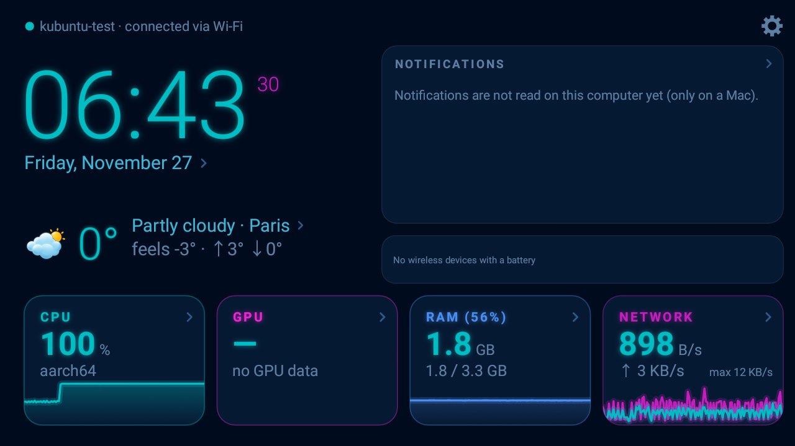
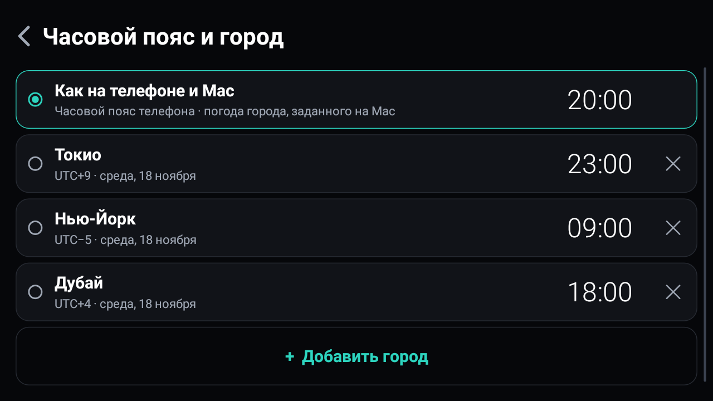

# deskstats

[](https://github.com/danijar2000/deskstats/actions/workflows/build.yml)

[English](../README.md) · [Русский](README.ru.md) · [Español](README.es.md) · [Deutsch](README.de.md) · [Français](README.fr.md) · **Português** · [中文](README.zh.md) · [日本語](README.ja.md)

Transforme um celular Android antigo em um painel de status para o seu Mac: relógio, clima,
notificações do Mac e do iPhone, bateria do mouse e do teclado, e carga de CPU, GPU, memória
e rede com gráficos ao vivo.


- **No Mac** roda um app minúsculo em segundo plano: cerca de 4 MB de memória e meio por cento
  de um núcleo enquanto o telefone está conectado, e nada quando não está.
- **O telefone** se conecta pelo cabo USB ou por Wi‑Fi e alterna entre os dois sozinho.
  Ele dorme e acorda junto com o Mac.
- **Tudo é configurado no telefone**: idioma, tema, orientação, quais blocos mostrar,
  com que frequência atualizar, acesso por Wi‑Fi.

## Capturas de tela

| | |
|---|---|
|  |  |
| Tema **Escuro**, o padrão | Tema **Neon** |
|  |  |
| Tema **Claro** | Orientação **Retrato** |
|  |  |
| Toque em um cartão de carga: os apps do Mac ordenados por essa carga | Toque nas notificações: a lista completa com os textos |
|  |  |
| Toque no relógio ou no clima: escolha uma cidade | A engrenagem: ajustes |

## Requisitos

- **Um Mac** com macOS 11 ou posterior (Apple silicon ou Intel).
- **Um telefone Android** com Android 2.3 ou posterior. A conexão USB precisa do Android 5.0;
  telefones mais antigos usam só Wi‑Fi, mas também precisam do cabo uma vez.
- **adb** no Mac para a conexão USB: `brew install android-platform-tools`.
- **Depuração USB** no telefone: Configurações → Sobre o telefone, toque em "Número da versão"
  sete vezes e depois em Configurações → Opções do desenvolvedor → Depuração USB. Permita a
  depuração para este Mac quando o telefone perguntar.

## Instalação

Conecte o telefone com um cabo e execute:

```bash
curl -fsSL https://raw.githubusercontent.com/danijar2000/deskstats/main/setup.sh | bash
```

O script baixa a última [versão](https://github.com/danijar2000/deskstats/releases), instala o
app do Mac em `~/Applications/Deskstats.app` para que ele abra no login e instala o app no
telefone. Alguns segundos depois, o Mac abre o painel no telefone e faz o pareamento com ele.

Sem telefone no cabo? Adicione `-s -- --no-phone` depois de `bash` e instale
[deskstats.apk](https://github.com/danijar2000/deskstats/releases/latest/download/deskstats.apk)
você mesmo.

### Permissões no Mac

Abra Ajustes do Sistema → Privacidade e Segurança e permita o **Deskstats** em:

- **Acesso Total ao Disco** — para as notificações dos apps do Mac.
- **Acessibilidade** — para as notificações encaminhadas do iPhone. O macOS as mantém apenas na
  tela, então o Deskstats as lê enquanto um banner está sendo exibido ou a Central de
  Notificações está aberta.

Todo o resto funciona sem elas. O Deskstats percebe as permissões sozinho em até meio minuto.
Depois de uma atualização, o macOS as pede de novo; se a chave já estiver ativada mas nada
chegar, remova o Deskstats da lista (−) e adicione `~/Applications/Deskstats.app` novamente.

## Uso

- **Os cartões de carga** (CPU, GPU, RAM, Rede) abrem os aplicativos do Mac ordenados por essa
  carga. A CPU é contada por núcleo, como no Monitor de Atividade: um app ocupando três núcleos
  mostra 300%.
- **O relógio e o clima** abrem a lista de cidades: adicione várias, escolha uma, remova com ×.
  O relógio, a data, o horário das notificações e o clima seguem a cidade escolhida.
- **As notificações** abrem a lista completa.
- **A engrenagem** abre os ajustes: idioma (8 idiomas), tema (escuro, claro, neon),
  orientação (paisagem, retrato, auto), os blocos da tela principal, conexão por Wi‑Fi,
  notificações do Mac, intervalo de atualização e atualização do clima.
- **Vários Macs**: ligue o telefone por cabo a cada Mac uma vez e ele lembra-se de todos. Deslize
  o ecrã principal para a esquerda ou para a direita para alternar; os pontos no topo mostram qual
  Mac está à vista. A lista (× para esquecer um Mac) está nos ajustes, em Macs.
- **Voltar** fecha uma página; uma página sem uso fecha sozinha depois de alguns minutos.

Para evitar marcas na tela, a imagem se desloca alguns pixels a cada dois minutos e a tela
escurece após cinco minutos sem o Mac. O painel inicia quando o telefone reinicia (até o
Android 9; em telefones mais novos, o Mac o abre via USB).

## Atualizar e remover

Para atualizar, execute o comando de instalação de novo. Se o telefone recusar o novo app por
causa de uma assinatura diferente, desinstale o antigo (os ajustes dele são perdidos) e execute
o comando novamente:

```bash
adb uninstall app.deskstats
```

Remover o app do Mac:

```bash
curl -fsSL https://raw.githubusercontent.com/danijar2000/deskstats/main/setup.sh | bash -s -- --uninstall
```

A chave de pareamento fica em `~/Library/Application Support/deskstats` (apague a pasta para
esquecer o telefone); as entradas em Privacidade e Segurança só podem ser removidas lá, à mão.

## Solução de problemas

| O que você vê | O que fazer |
|---|---|
| "Mac · sem conexão" | Verifique o cabo e `adb devices` (o telefone deve aparecer como `device`). Por Wi‑Fi: ative a conexão por Wi‑Fi nos ajustes do painel enquanto estiver no cabo e mantenha os dois na mesma rede. |
| "falta o token: conecte o telefone por USB" | Conecte o cabo: o Mac faz o pareamento com o telefone sozinho. |
| "o servidor recusou (código N)" | O app do telefone e o app do Mac são de versões diferentes: atualize os dois. |
| Sem notificações | Conceda as permissões acima. |
| Sem clima | Escolha uma cidade: toque no clima. |

## Segurança

O telefone e o Mac criptografam tudo o que trocam com uma chave que o telefone recebe uma única
vez pelo cabo; a chave em si nunca passa pela rede. Solicitações sem ela são recusadas antes de
qualquer coisa ser executada. Nada sai do Mac, exceto as coordenadas da cidade escolhida,
enviadas ao open-meteo.com para obter o clima.

## Compilar a partir do código-fonte

```bash
(cd server && cargo test && ./install.sh)
(cd android && ./gradlew :app:assembleRelease)
```

O servidor precisa de Rust; o app precisa do JDK 17+ e do Android SDK com a plataforma 34.
O [GitHub Actions](../.github/workflows/build.yml) compila os dois a cada push e publica uma
versão para cada tag `v*`.
