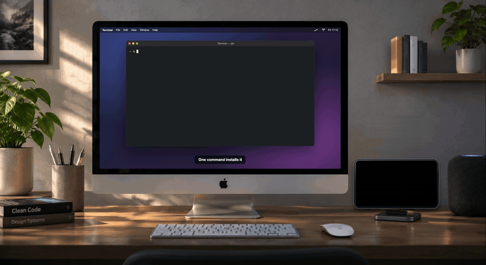
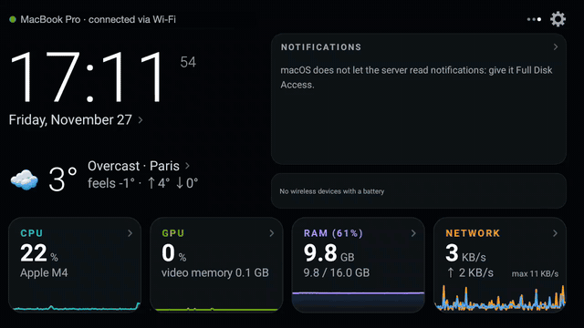

# deskstats

[](https://github.com/danijar2000/deskstats/actions/workflows/build.yml)

[English](../README.md) · **Русский** · [Español](README.es.md) · [Deutsch](README.de.md) · [Français](README.fr.md) · [Português](README.pt.md) · [中文](README.zh.md) · [日本語](README.ja.md)

Превратите старый Android‑телефон в панель состояния для Mac: часы, погода, уведомления
с Mac и iPhone, заряд мыши и клавиатуры, а также загрузка процессора, видеоядра, памяти
и сети с живыми графиками.

- **На Mac** работает крошечное фоновое приложение: около 4 МБ памяти и полпроцента одного
  ядра, пока телефон подключён, и ничего, когда он отключён.
- **Телефон** подключается по USB‑кабелю или по Wi‑Fi и сам переключается между ними.
  Он засыпает и просыпается вместе с Mac.
- **Всё настраивается на телефоне**: язык, тема, ориентация, какие блоки показывать,
  как часто обновлять, доступ по Wi‑Fi.

## Обзор

На компьютере: установка одной командой, два разрешения и панель под значком в строке меню. На телефоне: страницы приложения.

[](tour.mp4)

[Смотреть MP4](tour.mp4)

**Приложение на телефоне**

[](phone.mp4)

[Смотреть MP4](phone.mp4)

## Требования

- **Mac** с macOS 11 или новее (Apple silicon или Intel).
- **Android‑телефон** с Android 2.3 или новее. Для связи по USB нужен Android 5.0; старые
  телефоны работают только по Wi‑Fi.
- **adb** на Mac для связи по USB: `brew install android-platform-tools`.
- **Отладка по USB** на телефоне: Настройки → О телефоне, семь раз нажмите «Номер сборки», затем
  Настройки → Для разработчиков → Отладка по USB. Когда телефон спросит, разрешите отладку для этого Mac.

## Установка

Подключите телефон кабелем и выполните:

```bash
curl -fsSL https://raw.githubusercontent.com/danijar2000/deskstats/main/setup.sh | bash
```

Скрипт скачивает последний [релиз](https://github.com/danijar2000/deskstats/releases), ставит
приложение для Mac в `~/Applications/Deskstats.app` с автозапуском при входе и устанавливает
приложение на телефон. Через несколько секунд Mac открывает панель на телефоне и связывается с ним.

Телефон не подключён кабелем? Добавьте `-s -- --no-phone` после `bash` и установите
[deskstats.apk](https://github.com/danijar2000/deskstats/releases/latest/download/deskstats.apk)
вручную.

**Нет кабеля или adb?** Тогда скрипт покажет ссылку на приложение: откройте её на телефоне, установите приложение и откройте. В той же сети Wi‑Fi оно само найдёт компьютер; нажмите на него и разрешите телефон на компьютере. adb нужен только для USB‑кабеля.

### Разрешения на Mac

Откройте «Системные настройки» → «Конфиденциальность и безопасность» и разрешите **Deskstats**:

- **Полный доступ к диску** — для уведомлений приложений Mac.
- **Универсальный доступ** — для уведомлений, пересланных с iPhone. macOS держит их только на
  экране, поэтому Deskstats читает их, пока показан баннер или открыт Центр уведомлений.

Всё остальное работает и без них. Deskstats сам замечает выданные разрешения в течение
полуминуты. После обновления macOS запрашивает их снова; если переключатель уже включён, но
ничего не приходит, удалите Deskstats из списка (−) и снова добавьте `~/Applications/Deskstats.app`.

### Linux и Windows

Сервер работает и на Linux (x86-64 и ARM64, любой дистрибутив с systemd), и на Windows 10 и новее (64-бит). Приложение на телефоне то же самое.

Linux, в терминале:

```bash
curl -fsSL https://raw.githubusercontent.com/danijar2000/deskstats/main/setup.sh | bash
```

Windows, в PowerShell:

```powershell
irm https://raw.githubusercontent.com/danijar2000/deskstats/main/setup.ps1 | iex
```

- На Linux сервер лежит в `~/.local/bin/deskstats` и запускается при входе как пользовательская служба systemd; на Windows — в `%LOCALAPPDATA%\deskstats`, запускается при входе, журнал в `%APPDATA%\deskstats\log.txt`.
- Для USB‑кабеля установите adb: `sudo apt install android-tools-adb` (или пакет вашего дистрибутива) либо `winget install Google.PlatformTools`.
- Для Wi‑Fi откройте в брандмауэре TCP 8787 и UDP 8788. Чтобы пустить телефон по Wi‑Fi, на Linux нужен `zenity` или `kdialog`: он показывает вопрос.
- Пока не работает на этих системах: уведомления, заряд мыши и клавиатуры на Windows, загрузка GPU на Windows и на Linux кроме AMD, а также гашение телефона вместе с дисплеем.

## Использование

- **Карточки нагрузки** (CPU, GPU, RAM, Сеть) открывают приложения Mac, отсортированные по этой
  нагрузке. CPU считается по ядрам, как в Мониторинге системы: приложение, занявшее три ядра,
  показывает 300 %.
- **Часы и погода** открывают список городов: добавьте несколько, выберите один, удалите лишние ×.
  Часы, дата, время уведомлений и погода следуют выбранному городу.
- **Уведомления** открывают полный список.
- **Шестерёнка** открывает настройки: язык (8 языков), тема (тёмная, светлая, неон),
  ориентация (альбомная, книжная, авто), блоки главного экрана, связь по Wi‑Fi,
  уведомления Mac, частота обновления и обновление погоды.
- **Несколько Mac**: Mac с запущенным deskstats в той же сети Wi‑Fi видны в настройках, пункт
  «Компьютеры Mac», как устройства в LocalSend. Нажмите на Mac: телефон и Mac покажут одинаковый
  шестизначный код, и Mac спросит, пустить ли телефон. Ещё Mac добавляется, если один раз подключить
  к нему телефон кабелем. Свайп по главному экрану влево или вправо переключает Mac; точки вверху
  показывают, какой из них на экране. × — забыть Mac.
- **«Назад»** закрывает страницу; оставленная без внимания страница закрывается сама через
  несколько минут.

Чтобы экран не выгорал, изображение каждые две минуты сдвигается на несколько пикселей, а через
пять минут без Mac экран тускнеет. Панель запускается после перезагрузки телефона (до Android 9;
на более новых телефонах её открывает Mac по USB).

## Обновление и удаление

Обновление: снова выполните команду установки. Если телефон не принимает новое приложение из‑за
другой подписи, удалите старое (его настройки пропадут) и выполните команду ещё раз:

```bash
adb uninstall app.deskstats
```

Удаление приложения для Mac:

```bash
curl -fsSL https://raw.githubusercontent.com/danijar2000/deskstats/main/setup.sh | bash -s -- --uninstall
```

Ключ связи остаётся в `~/Library/Application Support/deskstats` (удалите папку, чтобы Mac забыл
телефон); записи в разделе «Конфиденциальность и безопасность» можно убрать только вручную.

На Linux сервер удаляет та же команда; на Windows — в PowerShell:

```powershell
& ([scriptblock]::Create((irm https://raw.githubusercontent.com/danijar2000/deskstats/main/setup.ps1))) -Uninstall
```

Ключ связи остаётся в `~/.config/deskstats` на Linux и в `%APPDATA%\deskstats` на Windows.

## Решение проблем

| Что вы видите | Что делать |
|---|---|
| «Mac · нет связи» | Проверьте кабель и `adb devices` (телефон должен быть в списке как `device`). По Wi‑Fi: включите «Связь по Wi‑Fi» в настройках панели, пока телефон на кабеле, и держите оба устройства в одной сети. |
| «нужен токен: подключите телефон по USB» | Подключите кабель: Mac сам свяжется с телефоном. |
| «сервер отказал (код N)» | У приложений на телефоне и на Mac разные версии: обновите оба. |
| Нет уведомлений | Выдайте разрешения, описанные выше. |
| Нет погоды | Выберите город: нажмите на погоду. |

## Безопасность

Телефон и Mac шифруют всё, что передают друг другу, ключом, который телефон получает по кабелю
или по Wi‑Fi, когда пользователь Mac это разрешит: тогда телефон и Mac договариваются о секрете по
ECDH (P-256), оба показывают шестизначный код из него, а ключ передаётся зашифрованным этим секретом.
Запросы без ключа отклоняются до того, как что‑либо выполнится. Каждый Mac сообщает в локальную сеть
своё имя, модель и адрес, чтобы телефоны могли показать его в списке; больше ничего открыто не отдаётся.
С Mac ничего не уходит, кроме координат выбранного города, которые отправляются на open-meteo.com за погодой.

## Сборка из исходников

```bash
(cd server && cargo test && ./install.sh)
(cd android && ./gradlew :app:assembleRelease)
```

Серверу нужен Rust; приложению — JDK 17+ и Android SDK с платформой 34.
[GitHub Actions](../.github/workflows/build.yml) собирает и то и другое при каждом push и
публикует релиз для каждого тега `v*`.
