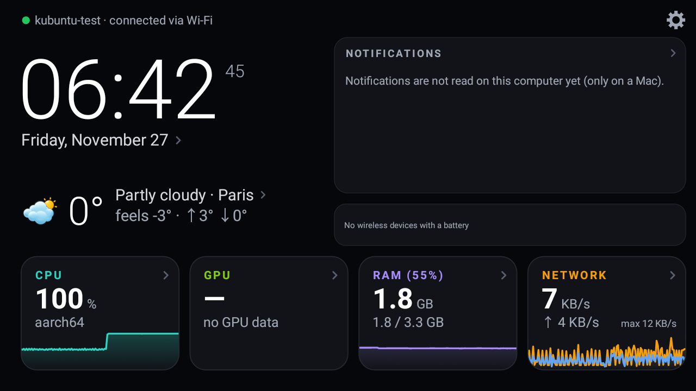
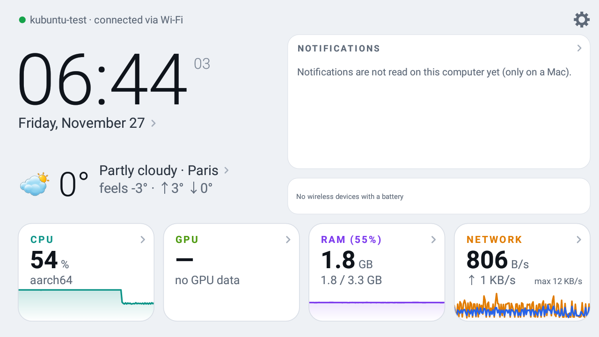

# deskstats

[](https://github.com/danijar2000/deskstats/actions/workflows/build.yml)

[English](../README.md) · [Русский](README.ru.md) · [Español](README.es.md) · [Deutsch](README.de.md) · [Français](README.fr.md) · [Português](README.pt.md) · **中文** · [日本語](README.ja.md)

把一台旧 Android 手机变成 Mac 的状态面板：时钟、天气、来自 Mac 和 iPhone 的通知、鼠标和键盘的电量，
以及带实时图表的 CPU、GPU、内存和网络负载。


- **Mac 端**是一个极小的后台应用：手机连接时约占 4 MB 内存和单核的 0.5%，未连接时不占任何资源。
- **手机**通过 USB 数据线或 Wi‑Fi 连接，并自动在两者之间切换。它随 Mac 一起休眠和唤醒。
- **所有设置都在手机上完成**：语言、主题、屏幕方向、显示哪些区块、刷新频率、Wi‑Fi 访问。

## 截图

| | |
|---|---|
|  |  |
| **深色**主题（默认） | **霓虹**主题 |
|  |  |
| **浅色**主题 | **竖屏**方向 |
|  |  |
| 点按负载卡片：按该负载排序的 Mac 应用 | 点按通知：带正文的完整列表 |
|  |  |
| 点按时钟或天气：选择城市 | 齿轮：设置 |

## 系统要求

- **Mac**：macOS 11 或更高版本（Apple 芯片或 Intel）。
- **Android 手机**：Android 2.3 或更高版本。USB 连接需要 Android 5.0；更旧的手机只能用 Wi‑Fi。
- Mac 上的 **adb**，用于 USB 连接：`brew install android-platform-tools`。
- 手机上开启 **USB 调试**：设置 → 关于手机，连续点按"版本号"七次，然后进入设置 → 开发者选项 →
  USB 调试。手机询问时，允许这台 Mac 进行调试。

## 安装

用数据线连接手机，然后运行：

```bash
curl -fsSL https://raw.githubusercontent.com/danijar2000/deskstats/main/setup.sh | bash
```

脚本会下载最新的 [发行版](https://github.com/danijar2000/deskstats/releases)，将 Mac 应用安装到
`~/Applications/Deskstats.app` 并设为登录时启动，同时在手机上安装应用。几秒钟后，Mac 会在手机上打开面板并与其配对。

手机没有接数据线？在 `bash` 后加上 `-s -- --no-phone`，然后自行安装
[deskstats.apk](https://github.com/danijar2000/deskstats/releases/latest/download/deskstats.apk)。

**没有数据线或没有 adb？** 脚本会显示一个带应用链接的二维码：用手机扫描，安装并打开应用。手机在同一 Wi‑Fi 下会自动找到电脑；轻点它，并在电脑上允许手机连接。只有使用 USB 数据线时才需要 adb。

### Mac 权限

打开系统设置 → 隐私与安全性，为 **Deskstats** 开启：

- **完全磁盘访问权限**——用于读取 Mac 应用的通知。
- **辅助功能**——用于读取从 iPhone 转发的通知。macOS 只在屏幕上显示这些通知，因此 Deskstats
  会在横幅显示或通知中心打开时读取它们。

没有这些权限，其他功能也都能正常使用。Deskstats 会在半分钟内自动识别权限。更新后 macOS 会再次请求权限；
如果开关已打开却收不到任何通知，请将 Deskstats 从列表中移除（−），再重新添加 `~/Applications/Deskstats.app`。

### Linux 和 Windows

服务端也可以在 Linux（x86-64 和 ARM64，任何带 systemd 的发行版）以及 Windows 10 或更高版本（64 位）上运行。手机应用是同一个。

Linux，在终端中：

```bash
curl -fsSL https://raw.githubusercontent.com/danijar2000/deskstats/main/setup.sh | bash
```

Windows，在 PowerShell 中：

```powershell
irm https://raw.githubusercontent.com/danijar2000/deskstats/main/setup.ps1 | iex
```

- 在 Linux 上，服务端位于 `~/.local/bin/deskstats`，登录时作为 systemd 用户服务启动；在 Windows 上位于 `%LOCALAPPDATA%\deskstats`，登录时启动，日志在 `%APPDATA%\deskstats\log.txt`。
- 使用 USB 数据线需要安装 adb：`sudo apt install android-tools-adb`（或你的发行版对应的软件包），或 `winget install Google.PlatformTools`。
- 使用 Wi‑Fi 需要在防火墙中放行 TCP 8787 和 UDP 8788。要通过 Wi‑Fi 允许手机连接，Linux 需要安装 `zenity` 或 `kdialog` 来显示确认窗口。
- 这些系统上暂未支持：通知、Windows 上鼠标和键盘的电量、Windows 以及非 AMD 的 Linux 上的 GPU 负载，以及手机随显示器一起熄屏。

## 使用

- **负载卡片**（CPU、GPU、RAM、网络）会打开按该负载排序的 Mac 应用。CPU 按核心计算，与活动监视器一致：
  占用三个核心的应用显示 300%。
- **时钟和天气**会打开城市列表：可添加多个城市、选择其中一个、用 × 删除。时钟、日期、通知时间和天气都跟随所选城市。
- **通知**会打开完整列表。
- **齿轮**会打开设置：语言（8 种）、主题（深色、浅色、霓虹）、屏幕方向（横屏、竖屏、自动）、
  主屏幕区块、Wi‑Fi 连接、Mac 通知、刷新间隔和天气刷新。
- **多台 Mac**：同一 Wi‑Fi 中运行 deskstats 的 Mac 会出现在设置的“Mac 电脑”中，就像 LocalSend 里的设备一样。
  轻点一台：手机和 Mac 会显示相同的六位代码，Mac 会询问是否让手机连接。用数据线把手机连接到 Mac 一次也能添加它。
  在主屏幕上向左或向右滑动即可切换；顶部的圆点显示当前是哪台 Mac。用 × 忘记某台 Mac。
- **返回**键关闭页面；无人操作的页面会在几分钟后自动关闭。

为防止烧屏，画面每两分钟移动几个像素，与 Mac 断开五分钟后屏幕会变暗。手机重启后面板会自动启动
（最高支持 Android 9；在更新的手机上由 Mac 通过 USB 打开）。

## 更新与卸载

更新：再次运行安装命令。如果手机因签名不同而拒绝安装新应用，请先卸载旧应用（其设置会丢失），然后再次运行命令：

```bash
adb uninstall app.deskstats
```

卸载 Mac 应用：

```bash
curl -fsSL https://raw.githubusercontent.com/danijar2000/deskstats/main/setup.sh | bash -s -- --uninstall
```

配对密钥保留在 `~/Library/Application Support/deskstats`（删除该文件夹即可忘记手机）；
"隐私与安全性"中的条目只能在那里手动移除。

## 故障排除

| 你看到的 | 解决方法 |
|---|---|
| "Mac · 未连接" | 检查数据线和 `adb devices`（手机应显示为 `device`）。使用 Wi‑Fi 时：在接着数据线的情况下，在面板设置中打开"Wi‑Fi 连接"，并让两台设备处于同一网络。 |
| "需要令牌：请用 USB 连接手机" | 接上数据线：Mac 会自动与手机配对。 |
| "服务器拒绝（代码 N）" | 手机应用和 Mac 应用版本不一致：将两者都更新。 |
| 没有通知 | 授予上面所述的权限。 |
| 没有天气 | 选择城市：点按天气。 |

## 安全

手机和 Mac 之间传输的所有内容都用密钥加密。手机通过数据线获取该密钥，或者在 Mac 用户允许后通过 Wi‑Fi 获取：
此时手机和 Mac 通过 ECDH（P-256）协商出一个共享秘密，双方都显示由它得出的六位代码，密钥用这个秘密加密后传输。
不带密钥的请求在执行任何操作之前就会被拒绝。每台 Mac 会在局域网中公布自己的名称、型号和地址，以便手机列出它；
除此之外没有任何开放内容。除了发送到 open-meteo.com 以获取天气的所选城市坐标外，没有任何数据离开 Mac。

## 从源码构建

```bash
(cd server && cargo test && ./install.sh)
(cd android && ./gradlew :app:assembleRelease)
```

服务器需要 Rust；应用需要 JDK 17+ 以及带平台 34 的 Android SDK。
[GitHub Actions](../.github/workflows/build.yml) 会在每次 push 时构建两者，并为每个 `v*` 标签发布一个版本。
